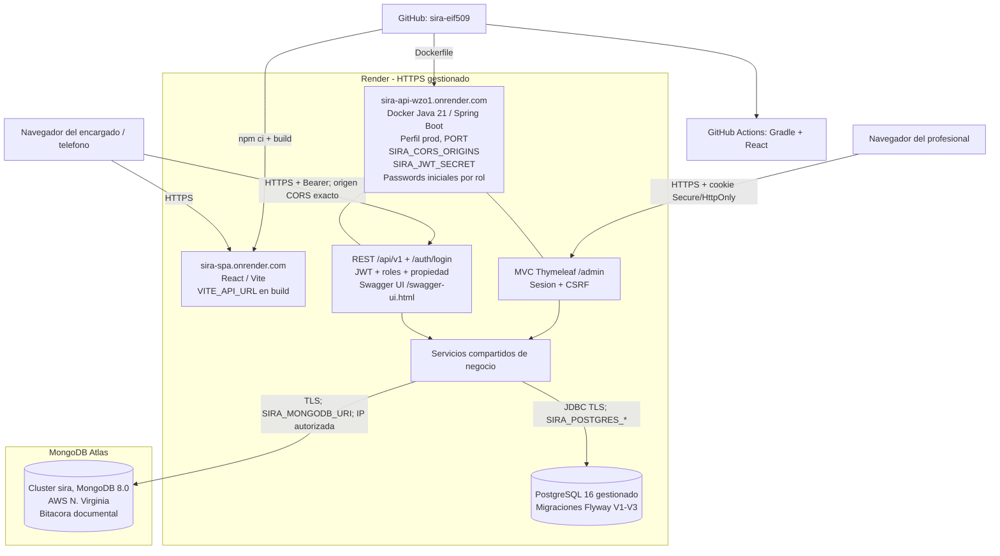

# Diagrama de despliegue - Laboratorio 6

Topologia aprovisionada el 22 de octubre de 2026 a partir de `render.yaml`.
La API y la SPA comparten la capa de negocio de SIRA. Las URLs y el estado de
verificacion se documentan en [entrega-lab6.md](entrega-lab6.md).

| Recurso | Servicio real |
|---|---|
| API y MVC | Render `sira-api`, Oregon; `https://sira-api-wzo1.onrender.com` |
| SPA | Render Static Site `sira-spa`; `https://sira-spa.onrender.com` |
| PostgreSQL | Render `sira-postgres`, PostgreSQL 16, Oregon; conexion interna con TLS |
| MongoDB | Atlas `sira`, nivel Free, MongoDB 8.0, AWS N. Virginia |
| Acceso Atlas | Usuario `sira_app`, `readWrite` solo en la base `sira`, restringido al cluster `sira` |
| Red Atlas | Solo los rangos de salida de Render mostrados para la API: `74.220.48.0/24` y `74.220.56.0/24` |

Los rangos de salida son compartidos por servicios de Render en la region;
la autenticacion y TLS siguen siendo obligatorios. La lista no incluye acceso
desde todas las IP de Internet.

| Ubicacion | Configuracion |
|---|---|
| Render, servicio API | Perfil, dominio SPA autorizado, clave JWT y passwords iniciales |
| Render, conexiones de PostgreSQL | Host, puerto, base, usuario y password; inyectados al servicio API |
| Render, build SPA | Origen HTTPS publico de la API; dato publico incorporado al bundle |
| Atlas | Usuario de base, permisos, TLS e IP/rangos de salida de la API permitidos |
| GitHub | Codigo, migraciones, definicion de infraestructura y CI; sin secretos de produccion |

La lista completa de nombres de variables esta en el README. API y MVC comparten
contenedor y origen. PostgreSQL y MongoDB se conectan por protocolos propios con
TLS; las interfaces web y Swagger se publican mediante HTTPS. Las bases no se
exponen como endpoints HTTP para el navegador.
